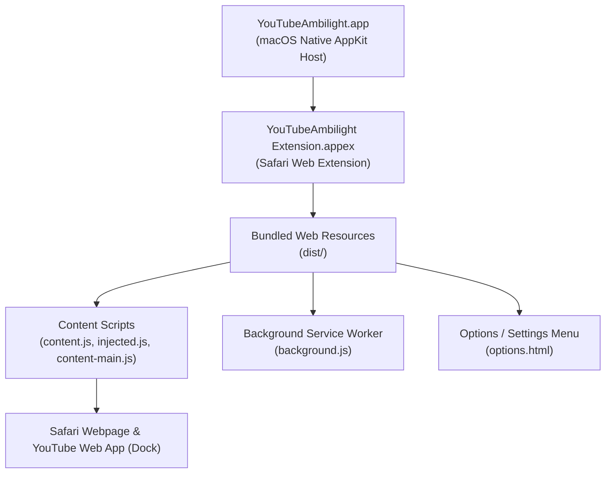

# YouTube Ambilight — macOS Application & Safari Web Extension

## 1. Overview

**YouTube Ambilight** for macOS is a native macOS host application (`YouTubeAmbilight.app`) bundling an embedded Safari Web Extension (`YouTubeAmbilight Extension.appex`). 

This architecture provides full compatibility with:
- **Safari for macOS** (macOS 12 Monterey through macOS 15 Sequoia).
- **Safari Web Apps (PWAs)** (YouTube added to Dock via Safari's "Add to Dock" on macOS Sonoma+).
- Standalone `.app` installation in `/Applications` without requiring Xcode or Developer Mode for daily use.

---

## 2. Architecture & Components



### 2.1 Native Host Application (`Xcode/YouTubeAmbilight`)
- **Framework**: Native Swift & AppKit (`NSViewController`, `NSApplication`).
- **Functionality**:
  - Live status detection of the extension using `SFSafariExtensionManager.getStateOfSafariExtensionWithIdentifier`.
  - Direct deep linking into Safari Extensions Settings via `SFSafariApplication.showPreferencesForExtension`.
  - Native macOS look and feel with dark/light mode support and dynamic status badges.
- **Sandboxing & Entitlements**:
  - `com.apple.security.app-sandbox = YES`
  - `com.apple.security.network.client = YES`
  - Configured for ad-hoc or Apple Developer ID signing.

### 2.2 Safari Web Extension Target (`Xcode/YouTubeAmbilight Extension`)
- **Plugin Bundle**: Standard `.appex` located in `Contents/PlugIns/`.
- **Extension Handler**: `SafariWebExtensionHandler.swift` bridging native messages if needed.
- **Manifest V3**:
  - Declarative permissions and content script injection rules.
  - Adapted `options_ui` for Safari (inline settings and popup).
  - Main world and isolated world script separation.

### 2.3 Web Engine (`src/`)
- **`ambientlight.js`**: Core ambient light calculation engine.
- **`projector-webgl.js`**: Hardware-accelerated WebGL glow renderer with multi-level scaling.
- **`canvas-webgl.js`**: WebGL texture and drawing buffer management.
- **`content.js` & `content-main.js`**: Lifecycle management, DOM observers, and YouTube SPA transition handlers.

---

## 3. Safari & WebKit Specific Adaptations

### 3.1 WebGL Buffer Retention
- **Issue**: Safari WebKit aggressively clears drawing buffers between composite frames when `preserveDrawingBuffer` is `false`, resulting in flickering or blank glow canvases.
- **Solution**: Set `preserveDrawingBuffer: true` for Safari to preserve texture integrity between animation frames.

### 3.2 Frame Timing & Display Synchronization
- **Issue**: WebKit's `HTMLVideoElement.requestVideoFrameCallback` and `video.webkitDecodedFrameCount` report timing differently than Chromium, causing frame drops when fading is disabled.
- **Solution**: Safari defaults to display framerate synchronization (`frameSync = 1`), decoupling frame presentation from video callback jitter.

### 3.3 Network Error Detection
- Added WebKit-specific `Load failed` exception handling in `src/scripts/libs/generic.js` to prevent uncaught promise rejections during fetch operations.

### 3.4 Safari Web App (PWA) Compatibility
- The application bundle registered in `/Applications` automatically provides the extension to Safari Web Apps created via "Add to Dock", enabling ambient lighting inside the standalone YouTube desktop window.

---

## 4. Build & Distribution Workflow

### 4.1 Prerequisites
- macOS 13+ with Xcode 15+ or Command Line Tools.
- Node.js (v18+) and npm.

### 4.2 One-Command Build and Install
```bash
npm run build:safari
```

This single command executes:
1. **`npm run build`**: Compiles Rollup scripts, SCSS styles, and copies assets to `dist/`.
2. **`xcodebuild`**: Builds `YouTubeAmbilight.xcodeproj` in Release/Debug configuration.
3. **`safari-install.js`**:
   - Copies `YouTubeAmbilight.app` to `/Applications/`.
   - Strips debug dynamic libraries (`__preview.dylib`).
   - Self-signs both `.app` and `.appex` with local codesign identity (`Apple Development` or ad-hoc `-`).
   - Registers the application with macOS `LaunchServices` (`lsregister`).

---

## 5. Verification Checklist

1. **Safari Extension Activation**:
   - Enable extension in Safari > Settings > Extensions.
   - Verify permissions granted for `youtube.com`.
2. **YouTube Web App**:
   - Launch YouTube from Dock (Safari Web App).
   - Verify ambient lighting renders correctly around the video player.
3. **Playback Scenarios**:
   - Standard 16:9, Cinema/Theater mode, Fullscreen, and Shorts.
   - Smooth 60 FPS rendering with zero frame stutter.
